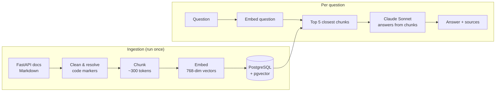
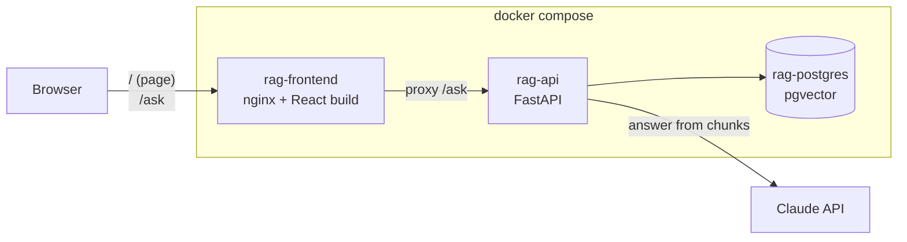

# rag-model-fastapi

[](https://github.com/acsiuc/rag-model-fastapi/actions/workflows/ci.yml)

A RAG system that answers questions about the FastAPI docs, built from scratch without LangChain.

You ask a question in a chat page, it finds the most relevant parts of the docs, and Claude answers using only those parts, with the pages it got the answer from.

It runs as three Docker containers (React + nginx, FastAPI, Postgres with pgvector), and I deployed it on AWS EC2 with HTTPS. The live version is offline now: the deployment was an exercise, and the steps are written down [below](#deployment-aws-ec2).

## Demo

The chat page sends your question to `POST /ask`:

```json
{"question": "My frontend on another port gets blocked when calling my API, how do I allow it?"}
```

What comes back (shortened):

```json
{
  "answer": "You add CORS support with `CORSMiddleware`... (from `tutorial/cors.md`)",
  "file_paths": ["tutorial/cors.md", "release-notes.md"]
}
```

The page shows the answer as Markdown, with the pages listed under **Sources**.

If the answer isn't in the docs, it says so:

```json
{"question": "What is the capital of France?"}
→ "I cannot find that information in the chunks."
```

## How it works



**Ingestion** (I run it once, with `scripts/ingest.py`)
1. **Load:** read all the docs pages, clean them up, and put the real example code where the docs only reference a file.
2. **Chunk:** split each page into sentences and group them into chunks of about 300 tokens, with a bit of overlap. Code blocks never get cut in half.
3. **Embed:** turn every chunk into a vector of 768 numbers.
4. **Store:** save each chunk with its vector in Postgres. That ends up as 2,531 chunks from 155 pages.

**Asking a question** (`POST /ask`)
1. **Retrieve:** turn the question into a vector the same way, and get the 5 chunks closest to it.
2. **Generate:** send those chunks and the question to Claude, and tell it to answer only from the chunks and cite the files.
3. **Respond:** send back the answer and the list of pages it came from.

## Architecture



- **rag-frontend:** nginx serves the built React page and passes `/ask` on to the API. The page and the API share one address, so there's no CORS to deal with. nginx also rate-limits `/ask` (3 questions per minute per IP, with a burst of 2), because every question costs Claude tokens.
- **rag-api:** the FastAPI app. `/ask` runs retrieval + generation, and `/health` checks the database connection.
- **rag-postgres:** Postgres with pgvector. The data lives in a named volume (`rag-pgdata`), so it survives containers being recreated.

Only nginx is reachable from outside. The API and Postgres are bound to `127.0.0.1`.

## Tech stack

| Part | What I used | Why |
|---|---|---|
| API | FastAPI + Pydantic | Request validation and a `/docs` page to test with |
| Database | PostgreSQL + pgvector | A real database that can also search by vectors |
| Embeddings | sentence-transformers `all-mpnet-base-v2` (CPU-only PyTorch) | Runs locally, free. The CPU build of PyTorch took the API image from 8.35 GB to 1.82 GB |
| Sentence splitting | NLTK | So chunks end at the end of a sentence, not in the middle |
| LLM | Claude Sonnet | Follows the "only answer from the chunks" instruction well |
| Frontend | React (Vite), Tailwind CSS, react-markdown | A simple chat page that renders the answer as Markdown |
| Serving | nginx | Serves the page, proxies `/ask`, rate limiting, HTTPS |
| Containers | Docker, Docker Compose | The same three containers run on my laptop and on the server |
| Deployment | AWS EC2, Let's Encrypt (certbot), DuckDNS | A rented Linux server, a free certificate, a free domain name |
| CI | GitHub Actions, Ruff, ESLint | Lint + build both images on every push |
| Tooling | uv, npm | Package management with lock files |

## Evaluation

I wrote 30 questions the way a beginner would ask them, and for each one I wrote down which docs page has the answer. The eval script checks if that page shows up in the chunks that come back.

It only runs the retrieval part, not Claude, so it doesn't cost anything to run.

**Result: 27/30 (90%)**, the same with 5 and with 8 chunks.

The 3 it misses are all basic intro pages: `first-steps.md`, `body.md` and `dependencies/index.md`. Instead, pages like `release-notes.md` and `bigger-applications.md` keep showing up, often several chunks from the same page. Getting 8 chunks instead of 5 didn't fix any of them, so the right pages are ranked even lower than that.

Run it with (Postgres has to be running and filled, see below):

```bash
uv run python evaluation/evaluation.py
```

## Getting started

You need Python 3.12+, [uv](https://docs.astral.sh/uv/), Docker, and an [Anthropic API key](https://console.anthropic.com/). Node 24 is only needed if you want to work on the frontend outside Docker.

```bash
# 1. Install the Python dependencies
uv sync

# 2. Add your secrets
cp .env.example .env
#    then fill in POSTGRES_PASSWORD and ANTHROPIC_API_KEY,
#    and add POSTGRES_HOST=localhost (used by the scripts that run outside Docker)

# 3. Build and start the three containers
#    (Postgres creates the table from db/schema.sql the first time)
docker compose up -d --build

# 4. Download the FastAPI docs into data/
uv run python scripts/fetch_data.py

# 5. Chunk, embed and save the docs into Postgres
#    (you can re-run it, it skips files that are already in)
uv run python scripts/ingest.py
```

Then open <http://localhost:8080> and ask something. The API's own docs page is at <http://localhost:8000/docs>.

### Environment variables

| Variable | What it's for | Default |
|---|---|---|
| `POSTGRES_PASSWORD` | The database password | required |
| `ANTHROPIC_API_KEY` | For the Claude calls | required |
| `POSTGRES_HOST` | Where the scripts find Postgres. Inside compose, the API always uses `rag-postgres` | set it to `localhost` |
| `FRONTEND_PORT` | Where the page is published (HTTP) | `127.0.0.1:8080` (only reachable from your own machine) |
| `HTTPS_PORT` | Where port 443 is published | `127.0.0.1:4433` |
| `NGINX_FILE` | Which nginx config to use: `default.conf` (HTTP) or `https.conf` (HTTPS + redirect) | `default.conf` |
| `RESTART_BEHAVIOUR` | The containers' restart policy | `no` |

The defaults are made for running it locally. Only the server's `.env` changes them.

### Working on the frontend

```bash
cd frontend
npm ci
npm run dev
```

Vite serves the page at <http://localhost:5173>, and its dev proxy passes `/ask` on to the API on port 8000, the same way nginx does in Docker.

### Linting

```bash
uv run ruff check            # Python
cd frontend && npm run lint  # React
```

## Deployment (AWS EC2)

I deployed it once to learn the whole path to production. The server ran the exact same `docker-compose.yml`, and only its `.env` was different.

1. **Server:** an EC2 `t3.small` (2 GB RAM) with Ubuntu 24.04 in Frankfurt and a 20 GB disk. I installed Docker from Docker's apt repository and cloned the repo.
2. **Firewall (Security Group):** SSH (22) only from my IP, HTTP (80) and HTTPS (443) open to everyone.
3. **Secrets:** a separate `.env` that only exists on the server (`chmod 600`), with its own database password and API key. Never in git.
4. **Data:** instead of running the ingestion again on the server, I exported the rows with `pg_dump --data-only`, copied the file with `scp`, and loaded it with `psql`.
5. **Server `.env`:** `FRONTEND_PORT=80`, `HTTPS_PORT=443`, `NGINX_FILE=https.conf` and `RESTART_BEHAVIOUR=unless-stopped`, so the site comes back by itself after a reboot.
6. **Domain:** a free DuckDNS subdomain, pointing at the instance's public IP.
7. **HTTPS:** a Let's Encrypt certificate from `certbot certonly --standalone`, with nginx stopped for a few seconds so certbot could answer the challenge on port 80. Compose mounts `/etc/letsencrypt` into the nginx container read-only. `https.conf` serves the site on 443 and redirects port 80 to HTTPS.
8. **Cost limits:** an AWS budget alert, a monthly spend limit on the Anthropic account, and the nginx rate limit on `/ask`.

Things I'd add to keep it running for real: certbot renewal hooks (stop the frontend before renewing, start it after), an Elastic IP or automatic DuckDNS updates (the public IP changes every time the instance starts), and a CD step that deploys after CI passes.

## CI

`.github/workflows/ci.yml` runs on every push to `main`, on a fresh Ubuntu machine:

1. Lint the Python code with Ruff
2. Install the frontend packages with `npm ci` and lint them with ESLint
3. Build the frontend image and the API image

## Project structure

```
src/rag_model_fastapi/
  ingestion/     loading, cleaning and chunking the docs
  retrieval/     finding the closest chunks
  generation/    the Claude call
  api/           the FastAPI endpoints (/ask, /health)
scripts/         fetch_data.py, ingest.py (one-off scripts)
evaluation/      the 30 eval questions and the eval script
db/schema.sql    the table, created by Postgres on first start
frontend/        the React page, its Dockerfile, and the nginx configs
```

## What's next

- [ ] Improve retrieval for the intro pages
- [ ] Unit tests (starting with the chunking: no chunk over the model's 384-token limit, code blocks never split)
- [ ] Leave the dev tools out of the API image (`uv sync --no-dev`)
- [x] A React chat frontend that calls `POST /ask`
- [x] Put the whole thing in Docker (API + database + frontend)
- [x] Deploy to AWS with HTTPS
- [x] CI with GitHub Actions
